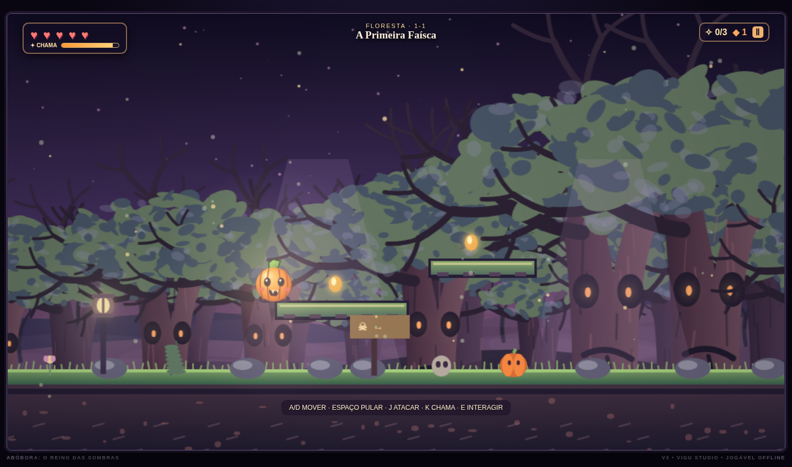
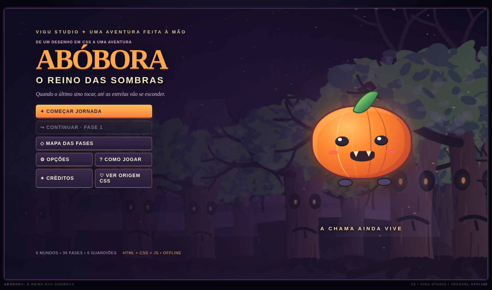
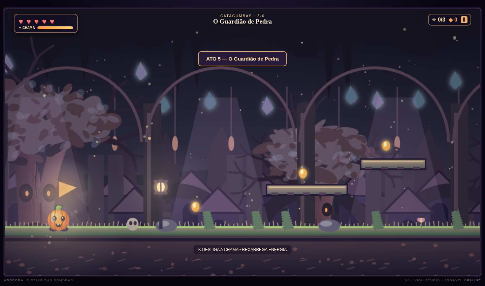
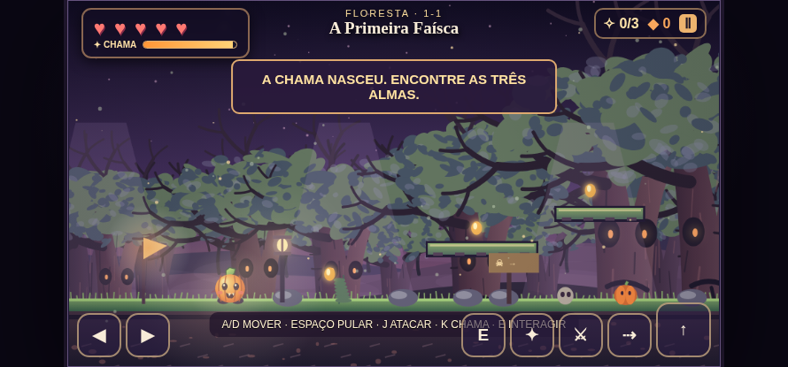

<div align="center">

# 🎃 ABÓBORA: THE KINGDOM OF SHADOWS
### From a CSS Pumpkin to a Playable Halloween Platformer

**Vigu Studio · Version 3 · HTML5 / CSS3 / Vanilla JavaScript**

A small pumpkin illustration turned into an original, gothic-fantasy, side-scrolling adventure — built entirely with native web technologies.

[**▶ Play on GitHub Pages**](https://gustavovitors.github.io/halloween-pumpkin-CSS/) · [**Original project**](https://github.com/GustavoVitorS/halloween-pumpkin-CSS) · [**Controls**](#-controls) · [**Development journey**](#-from-v1-to-v3-the-development-journey)

</div>

---

## 🌱 From V1 to V3: The Development Journey

The project began as **a single, friendly pumpkin drawn with HTML and CSS**. The current version evolves that same character — the orange body, curved stripes, green stem, expressive eyes, rosy cheeks and tiny fangs — into the hero of a fully interactive 2D platform game.

<table>
<tr>
<th align="center">V1 · Original HTML/CSS artwork</th>
<th align="center">V3 · Playable 2D adventure</th>
</tr>
<tr>
<td width="50%" align="center"></td>
<td width="50%" align="center"></td>
</tr>
<tr>
<td>One static character, constructed with CSS shapes.</td>
<td>Side-scrolling worlds, movement, combat, enemies, collectibles, camera and atmosphere.</td>
</tr>
</table>

### Milestones

| Version | What changed |
|:--|:--|
| **V1 — Halloween Pumpkin CSS** | A static pumpkin illustration built with HTML and CSS. This is where the character identity began. |
| **V2 — 16-bit Adventure Prototype** | First playable side-scroller: platforming, collectibles, enemies and multiple themed environments. |
| **V3 — The Kingdom of Shadows** | Reworked **Vanilla JS + Canvas 2D** engine; smoother movement mechanics, more elaborate hand-drawn-in-code scenery, flame powers, six worlds, boss encounters, menus and offline-oriented packaging. |

**The original V1 remains traceable in this repository's Git history.** The `original-reference/` directory includes a reconstructed HTML/CSS homage to the original pumpkin; it is not claimed to be an exact copy of the first commit.

---

## 🌙 Screenshots

<div align="center">

**Main menu**



**Haunted Forest — gameplay**


**Forgotten Catacombs**



**Touch-friendly controls**



</div>

*These are actual screenshots of the V3 renderer in a Chromium test environment, not promotional concept art.*

---

## ✨ Features

- **36 stages across 6 themed worlds** with deterministic, challenge-based stage composition.
- **Six boss encounters**, one in the final stage of each world.
- **Responsive platforming:** acceleration, variable-height jumps, jump buffering, coyote time, dash and unlockable double jump.
- **Pumpkin flame ability:** light dark areas, reveal spectral platforms and weaken supernatural enemies.
- **Arcade combat:** stomp enemies, perform melee attacks and shoot flame projectiles.
- **Collectibles and progression:** three souls per stage, candy, checkpoints and unlocked stages.
- **Atmospheric Canvas graphics:** parallax scenery, expressive trees, lighting, fog and particles.
- **Keyboard and touchscreen support**, pause menu, game settings and local progress saving when supported.
- **No runtime dependencies or build process.**

### 🗺️ The Six Worlds

| World | Setting |
|:--|:--|
| I · Pumpkin Forest | Living trees and the first flame |
| II · Village of Bells | Abandoned streets, rooftops and skeletons |
| III · Cemetery of Voices | Graves, fog and spectral bridges |
| IV · Misty Swamp | Dangerous ground, haze and swamp creatures |
| V · Forgotten Catacombs | Dungeons, spirits and hidden passages |
| VI · Castle of the Last Bell | Advanced challenges and the final confrontation |

**Level-design note:** The 36 stages are assembled from structured challenge sections; they are **not** 36 individually hand-authored maps. A full campaign playthrough has not been completed, so a 60-minute completion time has **not** been verified.

---

## 🎮 Controls

| Key | Action |
|:--|:--|
| `A` / `D` or `←` / `→` | Move |
| `Shift` | Run |
| `Space`, `W`, `↑` | Jump (hold to jump higher) |
| `J` | Attack (shoot a flame projectile while the flame is lit) |
| `K` or `F` | Toggle pumpkin flame |
| `L` | Dash |
| `E` | Enter a portal |
| `Esc` | Pause / resume |

On touch devices, on-screen buttons are displayed.

---

## 🚀 Play Locally — No Python Required

1. Download the repository as a ZIP or clone it.
2. Keep the directory structure intact.
3. Open **`index.html`** in a modern browser.
4. Select **Start Journey** (the in-game menu is in Portuguese).

The runtime uses **classic deferred JavaScript scripts**, not ES modules. It does not require Python, Node.js, npm, a bundler, a web server or a network connection. Game sounds are synthesized locally using the Web Audio API after user interaction.

> **Browser note:** This architecture is designed for direct `file://` access. Direct automated `file://` testing was blocked in the development environment, so exact behavior should be confirmed on your browser. Browser security rules can also affect local `localStorage`; if persistence is unavailable, the game handles the exception and may keep progress only for the current session.

## 🌐 Publish to GitHub Pages

1. Place `index.html`, `css/`, `js/`, `assets/`, `screenshots/` and the other project folders **at the repository root** (not inside an extra enclosing folder).
2. Commit and push to the repository's default branch.
3. Go to **Settings → Pages → Build and deployment**.
4. Select **Deploy from a branch**, your default branch (`main` or `master`) and **`/ (root)`**, then save.
5. Open the URL displayed in Pages settings. For this repository, the expected address is:

   **https://gustavovitors.github.io/halloween-pumpkin-CSS/**

The project uses relative file paths, so it is designed to work from GitHub Pages repository subdirectories.

---

## 🛠️ Technology & Project Structure

**HTML5 · CSS3 · JavaScript (ES5-style classic scripts / modern Vanilla JS APIs) · Canvas 2D · Web Audio API**

```text
index.html                 Entry point / menus / Canvas
css/style.css              UI, original-inspired CSS pumpkin, responsive layout
js/config.js               Settings and guarded browser storage
js/levels.js               Stage generation, worlds and bosses
js/input.js                Keyboard and touch input
js/audio.js                Sound and music synthesis
js/physics.js              Movement, collision, attacks and enemies
js/art.js                  World scenery and procedural artwork
js/render.js               Camera, parallax, lighting and rendering
js/ui.js                   HUD, options and menus
js/game.js                 Game loop and campaign rules
js/main.js                 Startup and error handling
assets/favicon.svg         Local favicon
original-reference/        Reconstructed tribute to the V1 art
screenshots/               V1-to-V3 evolution and in-game captures
tests/testes.html          Browser-based structure checks
```

Rendering uses `requestAnimationFrame` with a fixed-step 60 Hz simulation. Graphics quality, particles, lighting, camera shake, music, effects and volume can be adjusted in the settings menu.

## 🧪 Testing & Known Limitations

- Automated checks covered generation of all **36 stages**, three required souls per stage, six bosses, and ground beneath starting points and portals.
- Startup, movement, jumping, menus, pause/resume, stage transitions and several world renders were exercised in Chromium with the same game scripts injected into an HTML document.
- **Direct navigation with `file://` and full GitHub Pages deployment were not end-to-end tested** in that environment.
- No complete human playthrough of all 36 stages has been performed; balance, boss difficulty and total campaign length are not certified.
- Much of the artwork is drawn procedurally with Canvas rather than using hand-drawn pixel-art sprite sheets, and some stage patterns repeat.

To run browser-side checks, open `tests/testes.html`. If you encounter an issue, inspect your browser's Developer Tools (`F12` → Console).

---

## ❤️ Credits

- **Original HTML/CSS pumpkin concept:** [GustavoVitorS / halloween-pumpkin-CSS](https://github.com/GustavoVitorS/halloween-pumpkin-CSS)
- **Game direction and identity:** Vigu Studio
- **V3 gameplay and visual implementation:** developed specifically for this evolution
- **Art direction:** original Halloween fantasy; inspired by classic platformers' readability and movement feel, without using Nintendo sprites, maps, music or other proprietary assets.

<div align="center"><strong>From one CSS pumpkin to an entire haunted kingdom. 🎃</strong></div>
